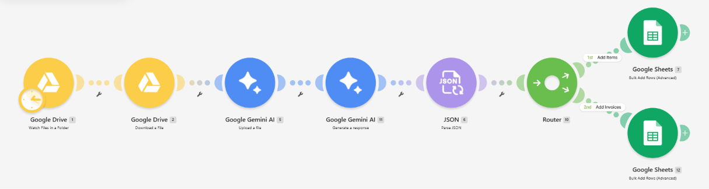
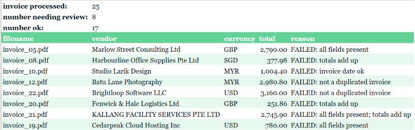

# Invoice Intake & Validation (Make + Gemini → Google Sheets)

   

Drop PDF invoices—clean or scanned—into a Drive folder. Gemini extracts each one, writes the data to Google Sheets, and automatically tags the row OK or NEEDS REVIEW with a clear reason.

## The problem
Manually entering invoices into a spreadsheet is slow and error‑prone. Even the most critical mistakes—wrong totals, duplicates, missing invoice numbers—can slip through. AI extraction speeds the process, but it introduces a new risk: the model may misread or fabricate a value.

**Question:** Which extracted invoices are trustworthy enough for payment, and which require a human review?

## How it works
1. Google Drive monitors a folder for new PDFs.  
2. Gemini parses each PDF and returns a strict JSON payload: header fields plus line items. Missing fields become `null`; no inference or calculation occurs.  
3. Router → Google Sheets writes header data to the `Invoices` sheet and line items to the `Items` sheet, linking them via the Drive file ID.  
4. Formulas evaluate every invoice and set its status. The `Review` tab shows only those that need a human check.

## Checks
| Check | Failure condition |
|---|---|
| All fields present | Vendor, invoice no., invoice date, currency, subtotal, tax or total is blank, or both payment terms and due date are blank |
| Not a duplicate | Same vendor + invoice no. appeared earlier |
| Invoice date OK | Invoice date is in the future |
| Due date OK | Due date precedes the invoice date |
| Totals add up | Subtotal + tax ≠ total (±0.01) |

The reason column lists **every** failed check, not just the first. If a due date is missing, it is derived from the invoice date plus payment terms.

## Results on the test set
- 25 synthetic invoices (5 scanned) from fictional vendors, with 8 seeded errors: 2 missing invoice numbers, 3 wrong totals, 1 future date, 2 duplicates.  
- All 8 errors were caught. No clean invoices were flagged. Every one of 76 line items was extracted correctly.

## Why this architecture?
- Make delivers a visual, scheduled pipeline that any client can read and maintain. No server to host.
- Gemini reads both digital and scanned PDFs directly—no separate OCR step.
- Google Sheets is familiar to the client. Validation logic lives in visible formulas, not hidden code.
- Two tables (Invoices + Items): invoices contain a variable number of line items, so they’re stored separately and linked by ID.

The validation layer exists because an AI model can misread values. Gemini doesn’t enforce data types, so numbers may return as text. The Drive trigger polls on a schedule rather than firing instantly. Each run consumes Make operations, which cost money at scale.

## Not checked
Bank details, GST/tax compliance, payment status, currency conversion, PO matching, line items vs subtotal.

## Known limitations
- Duplicate detection matches vendor + invoice number as text. Different spellings of the same vendor (“Pte. Ltd.” vs “Pte Ltd”) won’t match.
- Date checks use `TODAY()`, so a status can change when the sheet is reopened later.
- `sheets/Invoice_Validation.xlsx` is a snapshot exported from Google Sheets. Google‑only formulas appear as `__xludf.DUMMYFUNCTION` in Excel. View the live logic here: [[view‑only Google Sheet link](https://docs.google.com/spreadsheets/d/1T-AICuF9Pulj-H9npvPvo-TOh-N2gkdqWczKs50oY4w/edit?usp=sharing)].

## Repo contents
- `make/scenario-blueprint.json`: import into Make (Create scenario → ⋯ → Import Blueprint), then reconnect your own Google and Gemini accounts.
- `prompts/gemini_extraction_prompt.txt`: the extraction prompt. `{{1.name}}` and `{{1.id}}` are Make variables.
- `sheets/Invoice_Validation.xlsx`: output snapshot with all four tabs.
- `sample_invoices/`: the 25 test PDFs.

## Tech stack
Automation: Make  
AI extraction: Google Gemini API (Gemini 3.5 Flash)  
Input: Google Drive  
Output & validation: Google Sheets (ARRAYFORMULA, MAP, BYROW, LAMBDA, FILTER, XLOOKUP)  
Data format: JSON
